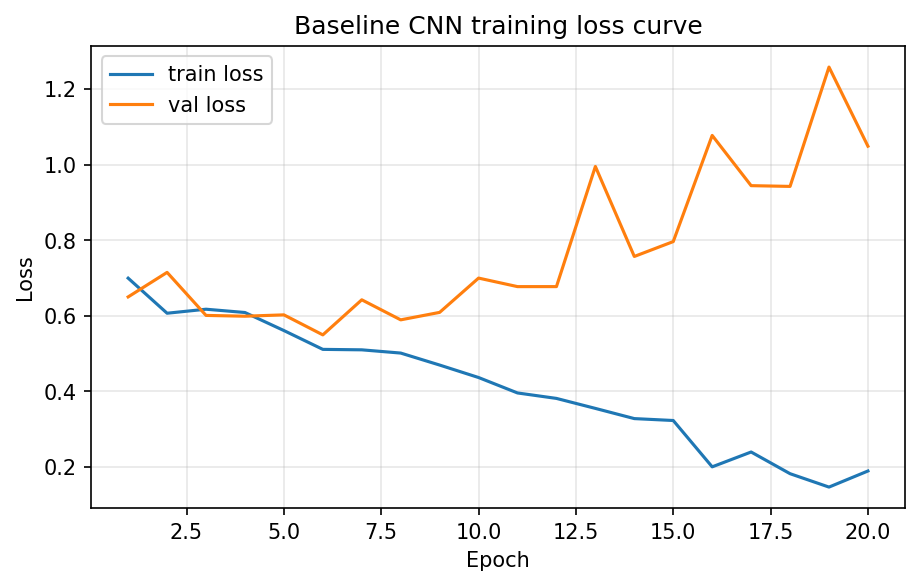
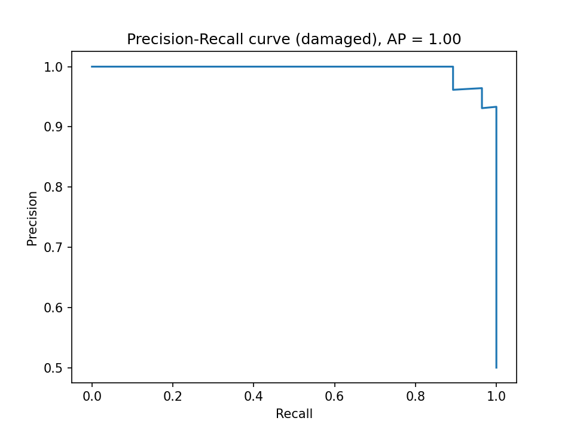
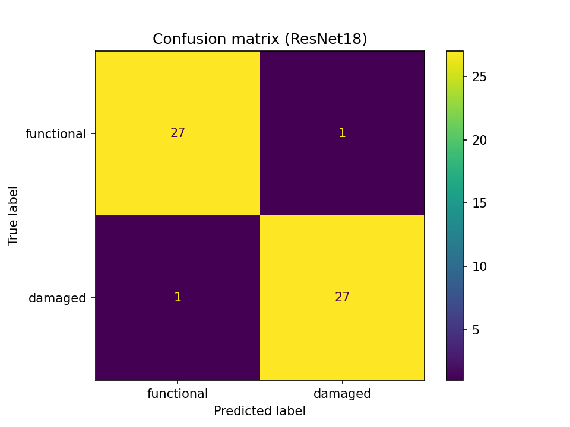
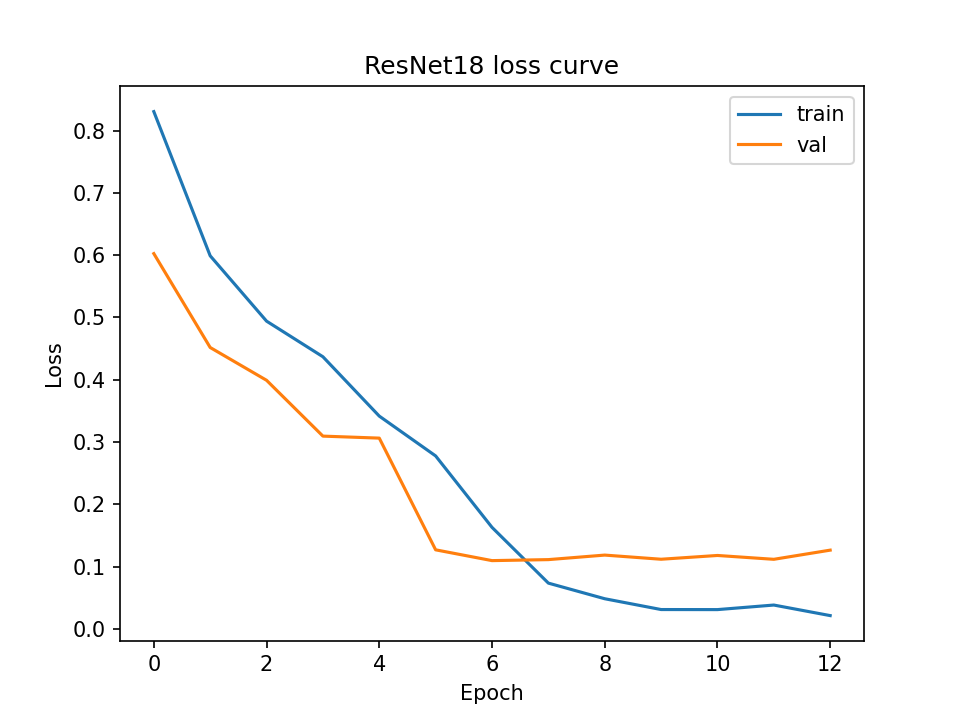

# Sports Equipment Condition Classifier

A binary image classifier that labels a photo of sports equipment as **Functional** or **Damaged**. It is built for Falcons Sports Club, so staff can find damaged equipment from photos and plan maintenance.

**Demo video of the `/predict` endpoint running on my laptop:** [Watch the demo](https://github.com/memuna-javedd/sports-equipment-condition-classifier/releases/download/v1.0/Sports.Equipment.Condition.Classifier.-.Swagger.UI.-.Brave.2026-11-25.22-14-53.mp4)

Hugging Face Docker Spaces now need a paid plan, so I did not deploy there. My mentor confirmed that a screen recording of `/predict` running locally, linked here, counts as the deployment for this task.

The project is built in three tasks:

| Task | What | Status |
|---|---|---|
| 1 | Data curation and baseline CNN | Done |
| 2 | Transfer learning (ResNet18) and robust evaluation | Done |
| 3 | FastAPI service, model card, deployment (demo video) | Done |

## Results at a glance

Damaged is treated as the positive class. All numbers are on the same validation set of 56 images (28 functional, 28 damaged).

| Model | Accuracy | Precision | Recall | F1 | AP |
|---|---|---|---|---|---|
| Baseline CNN (threshold 0.5) | 0.696 | 0.704 | 0.679 | 0.691 | 0.787 |
| ResNet18 transfer learning (threshold 0.60) | 0.964 | 0.964 | 0.964 | 0.964 | 0.995 |

The Task 2 target was an F1-score above 85% on the validation set. ResNet18 reaches 0.964. Please read the Limitations section before trusting this number too much.

## Dataset

276 images in total, perfectly balanced: 138 Functional and 138 Damaged. The split is 80/20 with a fixed random seed (42).

| Split | Functional | Damaged |
|---|---|---|
| train | 110 | 110 |
| val | 28 | 28 |

### Where the images came from

- **Functional (138 images):** taken from Google Open Images V7, using its "Sports equipment" class, downloaded with FiftyOne. Reference: Kuznetsova et al., "The Open Images Dataset V4", IJCV 2020. https://storage.googleapis.com/openimages/web/index.html
- **Damaged (138 images):** collected by hand. Most were downloaded manually from Google Images, by searching for terms like "cracked helmet" and "broken cricket bat" and saving results from the Images tab. About 10 to 15 of the damaged images are AI-generated.
- Images from web searches belong to their original owners and are used here only for educational purposes.

### Preprocessing

The preprocessing code is inside `notebook/model.ipynb` (it is not a separate script):

1. All raw files (including formats like webp and avif) are converted to RGB JPEG.
2. Images are resized to 128x128 with OpenCV and saved into `data/train` and `data/val`. The `data/` folder in this repo is this processed output.
3. For the baseline CNN, pixels are scaled to 0-1 and then normalized with mean 0.5 and std 0.5.

The raw images are not included in the repo. The `data/` folder is enough to re-run training.

## Project structure

```
data/                    train/ and val/, each with damaged/ and functional/ (128x128 JPEGs)
notebook/
    model.ipynb          Task 1: preprocessing, baseline CNN, training, loss curve
    transfer_learning.ipynb   Task 2: ResNet18, evaluation, plots, report
models/
    baseline_cnn.pth         baseline weights (final epoch)
    baseline_cnn_best.pth    baseline weights (best epoch)
assests/                 plots (folder name is spelled this way in the repo)
reports/
    training_report.md   Task 2 training report and comparison table
api/                     Task 3: FastAPI service (PyTorch), model weights, model card
deploy/                  Task 3: FastAPI service (ONNX Runtime), model.onnx, model card, export script
DECISIONS.md             decision log: why ResNet18 instead of the custom CNN
requirements.txt         dependencies for the notebooks
README.md
```

The ResNet18 weights file (`resnet18_best.pth`, about 45 MB) is not stored in this repo because it is too large for a normal GitHub upload. The API in Task 3 serves the baseline CNN instead (see below).

## Setup

Both notebooks were run on Google Colab (the baseline on CPU, the ResNet18 on CPU as well).

```
git clone https://github.com/memuna-javedd/sports-equipment-condition-classifier.git
cd sports-equipment-condition-classifier
pip install -r requirements.txt
jupyter notebook notebook/transfer_learning.ipynb
```

`transfer_learning.ipynb` reads the images from `data/train` and `data/val`, so run it from the repo's main folder.

## Task 1: Baseline CNN

A small CNN built from scratch in PyTorch:

- 3 convolution blocks (Conv, ReLU, MaxPool) with 16, 32 and 64 filters
- Flatten, Linear(128), Dropout(0.5), Linear(2)
- About 2.1 million parameters
- Training: 20 epochs, Adam (learning rate 1e-3), batch size 16, cross-entropy loss, random horizontal flip
- Input: 128x128 images

**Result:** 69.6% validation accuracy (39 of 56 images). Training accuracy climbs to about 92% while validation accuracy stays around 65-70% and validation loss rises after epoch 6. The model overfits, which is expected with only 220 training images.



## Task 2: Transfer learning and robust evaluation

The baseline was replaced with a pre-trained ResNet18 (ImageNet weights, from torchvision).

### What was done

- **Model:** ResNet18 with its last layer replaced by a new Linear layer with 2 outputs (damaged / functional).
- **Two-round training:**
  - Round 1: all ResNet layers frozen, only the new last layer trained for 5 epochs (Adam, learning rate 1e-3).
  - Round 2: the last ResNet block (`layer4`) is also unfrozen and trained for 8 more epochs with a small learning rate (1e-4), while the last layer keeps 1e-3.
  - The weights with the best validation F1 for the damaged class were saved.
- **Data augmentation (training images only):** random resized crop (scale 0.7 to 1.0, output 224x224), horizontal flip, rotation up to 15 degrees, and colour jitter. Validation images are only resized to 256 and center-cropped to 224.
- **Normalization:** the ImageNet mean and std that ResNet was trained with.
- **Class imbalance:** the loss uses class weights. The current data is balanced, so the weights are equal here, but real club photos will have far fewer damaged items than good ones, so the model is built and judged with that in mind.
- **Evaluation:** precision-recall curve, F1, and a confusion matrix, not just accuracy. The decision threshold was set to 0.60, the best precision among thresholds that keep recall at or above 90%, because missing a damaged item is the costly mistake for the club.

### Training progress

| Round | Epoch | Train loss | Val loss | Val F1 |
|---|---|---|---|---|
| 1 | 1 | 0.830 | 0.602 | 0.600 |
| 1 | 2 | 0.599 | 0.452 | 0.862 |
| 1 | 3 | 0.494 | 0.399 | 0.682 |
| 1 | 4 | 0.437 | 0.310 | 0.929 |
| 1 | 5 | 0.342 | 0.306 | 0.906 |
| 2 | 1 | 0.278 | 0.127 | 0.945 |
| 2 | 2 | 0.163 | 0.110 | 0.964 |
| 2 | 3 | 0.074 | 0.111 | 0.964 |
| 2 | 4 | 0.049 | 0.119 | 0.964 |
| 2 | 5 | 0.031 | 0.112 | 0.964 |
| 2 | 6 | 0.031 | 0.118 | 0.964 |
| 2 | 7 | 0.039 | 0.112 | 0.964 |
| 2 | 8 | 0.022 | 0.127 | 0.947 |

Best validation F1 (damaged class): 0.964.

### Final comparison

| Model | Accuracy | Precision | Recall | F1 | AP |
|---|---|---|---|---|---|
| Baseline CNN (threshold 0.5) | 0.696 | 0.704 | 0.679 | 0.691 | 0.787 |
| ResNet18 transfer learning (threshold 0.60) | 0.964 | 0.964 | 0.964 | 0.964 | 0.995 |

ResNet18 makes about 2 mistakes in 56 validation images, compared with about 17 for the baseline.

### Plots

Precision-recall curve:



Confusion matrix:



ResNet18 loss curve:



### Why ResNet18

The full reasoning is in [DECISIONS.md](DECISIONS.md). In short: the custom CNN overfits because 220 images are too few to learn good features from scratch, while ResNet18 has already learned general shapes and textures from millions of ImageNet photos and only needs to learn the last step. It is also small and fast, which suits deployment in Task 3.

The full training report is in [reports/training_report.md](reports/training_report.md).

## Task 3: API and model card

### What was built

A FastAPI service that accepts an image upload and returns the classification as JSON. There are two versions of the same service:

| Folder | Runs the model with | Model file |
|---|---|---|
| `api/` | PyTorch | `baseline_cnn_best.pth` |
| `deploy/` | ONNX Runtime (lighter install, no PyTorch) | `model.onnx`, exported with `deploy/convert_to_onnx.py` |

Both give the same output. Both resize the image to 128x128 and normalize it with mean 0.5 / std 0.5, the same preprocessing as training.

**The service uses the baseline CNN, not ResNet18.** Its validation accuracy is 69.6%, not the 96.4% of ResNet18, so predictions are much less reliable than the Task 2 numbers suggest. The model card reports the baseline's numbers for this reason.

### Endpoints

- `GET /` : simple page to upload an image and see the result
- `POST /predict` : send an image file in the form field `file`
- `GET /docs` : interactive Swagger UI

Example request:

```
curl -X POST -F "file=@photo.jpg" http://127.0.0.1:8000/predict
```

Example response:

```
{"label": "damaged", "confidence": 0.82, "needs_human_review": false}
```

- `label`: `damaged` or `functional`
- `confidence`: probability of the predicted label
- `needs_human_review`: `true` when confidence is below 0.7

Errors: `400` if the file is not a valid image, `413` if it is too large (5 MB in `api/`, 4 MB in `deploy/`).

### Run it locally

```
cd api
pip install -r requirements.txt
uvicorn main:app --reload
```

Then open http://127.0.0.1:8000/docs. For the ONNX version, run the same commands inside `deploy/`.

### Deployment

The demo video at the top of this README shows `/predict` running locally in Swagger UI. As agreed with my mentor, this replaces the Hugging Face Spaces deployment because Docker Spaces need a paid plan.

### Model card

[api/MODEL_CARD.md](api/MODEL_CARD.md) covers intended use, out-of-scope use, training data, performance, limitations and ethics. In short: it is a screening aid only, a person must make the final decision, and it must not be used for safety-critical gear such as helmets. The most serious mistake is calling damaged equipment functional.

## Limitations

- **Small dataset:** 276 images in total. More data, especially more varied damaged photos, would make the results more reliable.
- **Small validation set:** only 56 images (28 per class). One wrong image changes the F1 score by roughly 2 points, so scores can move by several points between runs.
- **Slightly optimistic score:** the same validation set was used to choose the best epoch and the decision threshold (0.60). There is no separate test set, so 0.964 is probably a little higher than what the model would score on completely new photos.
- **Image sources:** the damaged images were collected from Google Images by hand and about 10 to 15 are AI-generated. They may include noise or near-duplicates, and AI-generated damage may not look exactly like real wear and tear. The functional images come from a different source than the damaged ones, so the model may partly learn the difference between sources and not only the difference between good and damaged.
- **Image size:** the saved images are 128x128 and are enlarged to 224x224 for ResNet18, which loses some fine detail such as small cracks.
- **Balanced classes:** the dataset is 50/50, but real equipment photos will have many more functional items, so precision on real data will likely be lower than reported here.
- **Deployed model:** the API serves the baseline CNN (69.6% validation accuracy), not ResNet18, and was only demonstrated locally, not hosted publicly.
